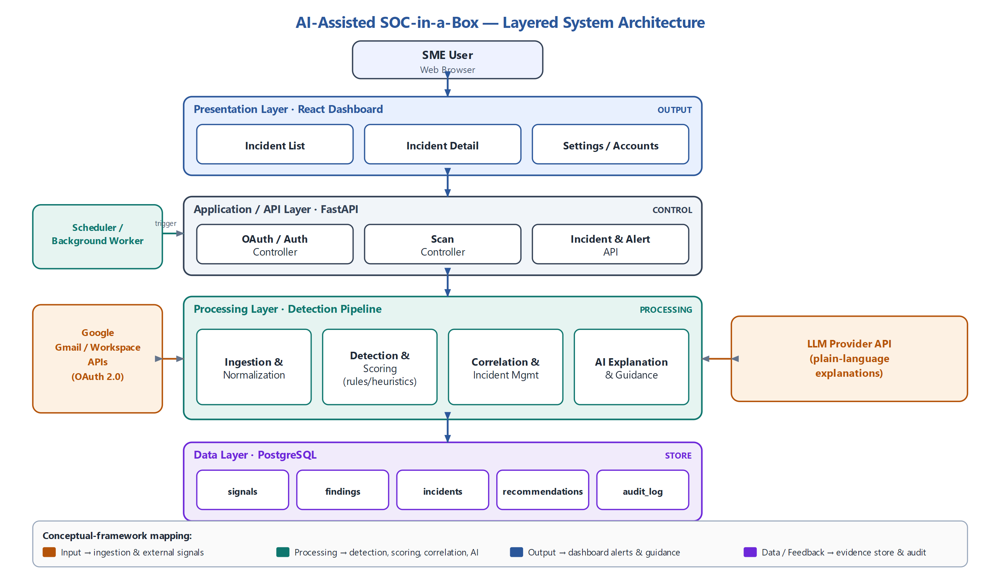
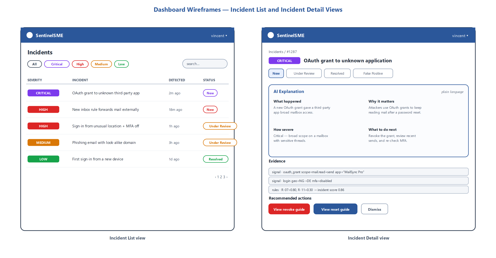
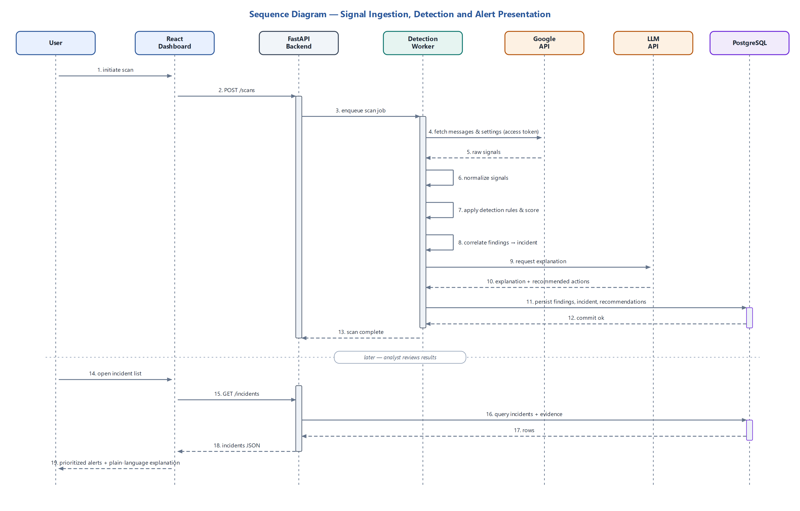

# LindaBiz

[](https://github.com/Vince106888/ai-soc-prototype/actions/workflows/ci.yml)

LindaBiz is a privacy-aware, AI-assisted SOC-in-a-box research prototype for
individuals, micro-organisations, and small businesses that use cloud email but
do not have a dedicated security analyst. It turns authorised or controlled
email and account-security signals into traceable, prioritised incidents with
plain-language explanations and safe next steps.

The platform is defensive by design. Rules create findings, transparent maths
sets priority, and a human decides what happens next. No model is allowed to
create evidence, change a score, or take action on an account.



## Public product deployment

Public Google registration, server-owned private workspaces, secure sessions,
account deletion, configurable evidence retention and a standalone HTTPS Docker
stack are implemented. The deployment package targets a VPS/domain selected
later. See [public deployment](docs/PUBLIC_DEPLOYMENT.md) for initialization,
Google configuration, backups, recovery and the final live-release checks.
Optional Gmail remains disabled until the actual deployment is approved for its
scope. Optional AI explanations run independently of collection.

## Platform status

This repository now contains an end-to-end **controlled-data** workflow:

- persistent accounts, sources, scan jobs, signals, rules, findings, incidents,
  explanations, recommendations, and audit records;
- normalisation and deterministic detection for email, forwarding, sign-in,
  MFA, and OAuth-grant signals;
- idempotent batch ingestion, 30-minute correlation, bounded risk aggregation,
  incident lifecycle controls, and tenant-scoped retrieval;
- a versioned FastAPI surface plus the original single-message analysis route;
- a React dashboard for overview, incident triage, evidence review, lifecycle
  changes, controlled source setup, coverage, and persisted scan-job history;
- template explanations and safe advisory actions;
- a labelled-case evaluation endpoint that reports a confusion matrix and
  accuracy, precision, recall, specificity, and F1 score.

A read-only personal Gmail adapter now implements OAuth consent, encrypted
tokens, refresh, bounded on-demand inbox scans, separately acknowledged scheduled samples, and disconnect. It requires your
Google Web OAuth client. Mocked provider tests cover its contracts, and an
authorised local consent-and-scan trial succeeded on 4 October 2026. That trial
validates the integration, not threat-detection accuracy. See [Gmail setup](docs/GMAIL_SETUP.md).

The dashboard supports selected-email analysis, database-backed workspace totals,
seven-day activity, readable evidence, and account deletion. Development Gmail trial
accounts expire after seven days; production keeps connections and applies configurable evidence retention.
Opt-in scheduled sampling now executes through a leased worker; see [scheduling](docs/SCHEDULING.md). High and critical incidents raise in-app and optional webhook alerts; see [alerts](docs/ALERTS.md). An **Ask LindaBiz** panel explains incidents from stored findings without a model; see [assistant](docs/ASSISTANT.md).
Workspace admin telemetry and automatic remediation remain absent. Public deployment uses the separate hardened Compose package described above. Generic jobs record work; selected-email
submission and the Gmail scan route actually execute analysis.

Google app sign-in is implemented behind `AI_SOC_AUTH_MODE=google`,
with verified identity, private server-assigned workspaces, eight-hour sessions
and CSRF protection. Public deployments support self-registration; private pilots may retain an invitation list. A guided welcome page separates sign-in from optional
Gmail consent; local demos remain available. Synthetic tests cover access and
isolation; controlled public HTTPS deployment acceptance passed. Live Google sign-in on the final public domain remains a release check. Configure the extra callback once using [onboarding](docs/ONBOARDING.md).

## Why it exists

Native cloud alerts are often spread across inboxes, browser warnings, identity
dashboards, and administrator consoles. Enterprise SIEM and SOC products can
centralise this information, but their cost and operating complexity are often
unrealistic for a small organisation. LindaBiz explores a narrower question:

> Can selected cloud-email and account-security indicators be collected with
> consent, correlated transparently, and explained well enough for a
> non-specialist to take timely defensive action?

The prototype focuses on the evidence path, not on claiming certainty:

```text
controlled signal -> minimise and normalise -> deterministic rules
                  -> findings -> correlate -> score and prioritise
                  -> explanation + safe guidance -> human review -> audit
```

## What users can do

- Register a controlled account and one or more sources.
- Submit up to 500 controlled signals in an ingestion batch.
- Review incidents ordered by severity and filter them by severity, status,
  account, or search text.
- Trace an incident back to its normalised signals, rules, weights, confidence,
  and supporting evidence.
- Move an incident through valid review states with an audit note.
- Inspect the configured detection catalogue and platform capability report.
- Run labelled evaluation cases without persisting private message content.

The dashboard follows the incident-list and evidence-first detail design from
the project report:



## Architecture

LindaBiz is a modular monolith with explicit service boundaries:

| Layer | Current implementation |
|---|---|
| Presentation | React/Vite single-page dashboard |
| HTTP/API | FastAPI health, compatibility analysis, and `/api/v1` platform routes |
| Processing | Normalisation, configurable rules, scoring, correlation, lifecycle, templates, evaluation |
| Persistence | SQLAlchemy; SQLite by default and PostgreSQL-compatible configuration |
| External integrations | Read-only personal Gmail adapter; optional loopback Ollama explainer validated on synthetic laptop incidents; Workspace admin absent |



The default SQLite database is created at `data/lindabiz.db`. Set
`AI_SOC_DATABASE_URL` to use another SQLAlchemy database URL. The repository
ships an Alembic migration and a Docker Compose deployment that builds the
dashboard and API and runs them with PostgreSQL.

See [DATA_MODEL.md](docs/DATA_MODEL.md) for the persisted evidence chain and
[OPERATIONS.md](docs/OPERATIONS.md) for deployment boundaries.

## Quick start

### Portable launch (Windows, Linux, macOS)

With Docker Desktop/Engine running and Python 3 available, run from the checkout:

```bash
python scripts/run.py docker --demo
```

This builds the dashboard/API image, starts private PostgreSQL and the worker,
waits for readiness, seeds only synthetic tenant `demo`, and runs HTTP acceptance
checks. It creates persistent random deployment secrets in ignored
`data/docker.env`; preserve this private file with your database volume. Open
`http://127.0.0.1:8000`, choose **Open an existing local workspace**, enter `demo`
and the deployment key from that private file. No Google setup is needed.
Use `python3` if that is your platform's Python command.

```bash
python scripts/run.py doctor
python scripts/run.py check
python scripts/run.py down
```

Stopping retains database volumes. `--port 8001` selects another host port.
For optional container-local AI, add `--model` to launch/check/down commands;
launch downloads `qwen2.5:3b` into its own named model volume. The API, worker
and Ollama share a network namespace so model traffic remains loopback-only;
no Ollama port is published. Host-installed models are separate from that volume.

Without Docker, use Python 3.13, uv and Node.js/npm:

```bash
python scripts/run.py local --demo --model
```

This builds and serves the console and API together, using the separate
`data/portable-demo.db`; it does not seed your existing application database.
Omit `--model` for templates only. After the first build, `--skip-build` reuses
the dashboard. Keep the terminal open; Ctrl+C stops the local server.
See [operations](docs/OPERATIONS.md) for backup and deployment limits.

### Prerequisites

- Python 3.13
- [uv](https://docs.astral.sh/uv/)
- Node.js 20.19+ or 22.12+ and npm for the dashboard

### 1. Start the API

```bash
git clone https://github.com/Vince106888/ai-soc-prototype.git
cd ai-soc-prototype
uv sync --dev --frozen
uv run alembic upgrade head
uv run uvicorn app.main:app --reload --no-access-log
```

Open [http://127.0.0.1:8000/docs](http://127.0.0.1:8000/docs) for the generated
OpenAPI interface. Liveness is available at
[http://127.0.0.1:8000/health](http://127.0.0.1:8000/health), while
`/health/ready` also verifies database reachability.

### 2. Start the dashboard

In a second terminal:

```bash
cd frontend
npm ci
npm run dev
```

Open [http://127.0.0.1:5173](http://127.0.0.1:5173). The development server
proxies `/api` to `http://127.0.0.1:8000`. Set `VITE_API_BASE_URL` when the API
is exposed through a same-origin reverse proxy at another base path.

To seed the labelled controlled scenario pack into the local database:

```bash
uv run python -m app.demo
```

For a containerised PostgreSQL deployment, copy `.env.example` to `.env`, set
both secrets, then run `docker compose up --build`. The console and API are
served together at [http://localhost:8000](http://localhost:8000).

### 3. Create controlled data

The Email analysis dashboard provides selected-message submission; [Gmail setup](docs/GMAIL_SETUP.md) covers live personal Gmail. The API batch path follows. A minimal sequence is:

1. `POST /api/v1/accounts`
2. `POST /api/v1/accounts/{account_id}/sources`
3. `POST /api/v1/scan-jobs`
4. `POST /api/v1/sources/{source_id}/signals`
5. `GET /api/v1/incidents`
6. `GET /api/v1/incidents/{incident_id}`
7. `PATCH /api/v1/incidents/{incident_id}/status`

Every request under `/api/v1` accepts an `X-Tenant-ID` header; it defaults to
`default`. If `AI_SOC_API_KEY` is configured, the same routes also require its
value in `X-API-Key`. These headers provide a controlled prototype boundary,
not production user identity or enterprise multi-tenancy.

The original `POST /analyze` route remains available for a stateless,
single-message demonstration using `fixtures/suspicious_email.json`.

Full request examples and endpoint semantics are in [API.md](docs/API.md).

## Detection catalogue

The persistent pipeline seeds fourteen versioned deterministic rules:

| Rule | Signal | Indicator | Weight | Confidence |
|---|---|---|---:|---:|
| `EMAIL-001` | email | Reply-to domain differs from sender domain | 0.45 | 0.95 |
| `EMAIL-002` | email | Urgent or credential-seeking language | 0.30 | 0.85 |
| `URL-001` | email | Known URL-shortening host | 0.30 | 0.98 |
| `URL-002` | email | Credential-themed hostname label | 0.45 | 0.80 |
| `EMAIL-003` | email | Sender domain resembles a declared trusted domain | 0.65 | 0.85 |
| `EMAIL-004` | email | Recognised brand name conflicts with the sender domain | 0.55 | 0.85 |
| `EMAIL-005` | email | SPF, DKIM, or DMARC authentication failure | 0.55 | 0.95 |
| `EMAIL-006` | email | Payment-change phrase plus payment instruction (bank or mobile money) | 0.50 | 0.75 |
| `EMAIL-007` | email | First message from a sender already asks for a payment change | 0.35 | 0.80 |
| `EMAIL-008` | email | Mobile-money reversal or tax-penalty pressure wording | 0.30 | 0.70 |
| `FORWARD-001` | forwarding | Enabled, external, unauthorised forwarding | 0.70 | 0.95 |
| `SIGNIN-001` | sign-in | Unusual, new-device, impossible-travel, or high-risk sign-in | 0.65 | 0.80 |
| `MFA-001` | MFA | Multi-factor authentication disabled | 0.60 | 0.99 |
| `OAUTH-001` | OAuth grant | Broad or unverified third-party grant | 0.80 | 0.90 |

`EMAIL-001`, `EMAIL-002`, `URL-001`, `URL-002` and `EMAIL-008` are skipped for a
workspace-trusted sender whose authentication did not fail; see
[RULE_CATALOG.md](docs/RULE_CATALOG.md#trusted-senders-and-first-contact).

Rules persist only the evidence fields they need. For email signals, the body is
reduced to matched phrases; URLs are reduced to canonical hostnames. Submitted
URLs are never fetched.

The legacy `/analyze` endpoint uses a separate historical 0–100 additive scale.
Do not compare that score directly with persistent incident scores. The full
catalogue and both scoring contracts are documented in
[RULE_CATALOG.md](docs/RULE_CATALOG.md).

## Scoring, correlation, and lifecycle

Persistent incident scores use bounded accumulation:

```text
combined score = 1 - product(1 - finding weight)
```

For example, related findings weighted `0.80` and `0.30` produce
`1 - (0.20 x 0.70) = 0.86`. This rewards corroborating evidence without letting
many weak findings push the score above `1.00`. A score is a review priority,
not the probability that an attack occurred.

| Score | Severity | Interpretation |
|---:|---|---|
| 0.00–0.29 | Low | Weak or isolated evidence; review when practical |
| 0.30–0.59 | Medium | Confirm whether the activity was expected |
| 0.60–0.79 | High | Prompt investigation required |
| 0.80–1.00 | Critical | Immediate review and containment guidance required |

Findings correlate only when they belong to the same account, share a
correlation key, and fall within the 30-minute window. Valid user transitions
are:

```text
New ---------> Under review ---------> Resolved
 |                   |                    |
 +--> False positive +--> False positive +--> Under review (reopen)
```

New related evidence automatically reopens a resolved incident. Every accepted
transition is written to the audit log.

## Privacy and security

The repository is for synthetic, controlled, or explicitly authorised data.
Do not submit real credentials, access tokens, private mailboxes, malware, or
third-party data without permission.

Implemented safeguards include:

- strict request contracts, bounded fields and batches, and unknown-field
  rejection;
- no attachment or raw-message fields in persistent signal ingestion;
- feature minimisation before persistence;
- idempotency through stable source/external identifiers and fingerprints;
- tenant-scoped platform queries and optional constant-time API-key checking;
- host allow-listing, one-megabyte body limits, redacted validation failures,
  no-store responses, and defensive browser headers;
- deterministic templates when no AI service exists;
- an evidence and audit trail for every persisted incident.

Important limitations remain: `X-Tenant-ID` is caller-supplied, the API key is a
shared deployment secret, database encryption and TLS depend on the operator,
and there is no production identity provider or rate limiter. Gmail tokens are encrypted; seven-day local trial expiry is enforced when the app runs. General production retention remains pending. Read [PRIVACY_AND_RETENTION.md](docs/PRIVACY_AND_RETENTION.md)
and [SECURITY.md](SECURITY.md) before deployment.

## Evaluation

The project evaluates both technical correctness and alert usefulness. The
implemented `/api/v1/evaluation` endpoint runs labelled controlled signals and
returns a confusion matrix plus accuracy, precision, recall, specificity, and
F1. Unit and API tests cover validation, rules, scoring, idempotency, tenant
isolation, lifecycle transitions, persistence, filters, and failure paths.

Report-level targets still requiring a documented study include:

- process up to 500 prepared message records and surface results within five
  minutes on the development computer;
- have at least 80% of evaluation participants identify the highest-priority
  incident, its reason, and the next step within three minutes unaided;
- calibrate weights and thresholds against a representative labelled set.

See [EVALUATION.md](docs/EVALUATION.md) for reproducible commands and the
difference between automated coverage and research evidence.

## Development checks

```bash
uv sync --dev --frozen
uv run ruff check .
uv run pytest --cov=app --cov-report=term-missing

cd frontend
npm ci
npm run lint
npm test
npm run build
```

Do not commit generated databases, credentials, tokens, real mailbox exports,
or screenshots containing private data. Read [AGENTS.md](AGENTS.md) and
[CONTRIBUTING.md](CONTRIBUTING.md) before changing the system.

## Documentation index

| Document | Purpose |
|---|---|
| [Capability matrix](docs/CAPABILITY_MATRIX.md) | Honest implemented/partial/not-implemented boundary |
| [API reference](docs/API.md) | Routes, headers, schemas, and controlled workflow |
| [Data model](docs/DATA_MODEL.md) | Tables, relationships, invariants, and evidence chain |
| [Rule catalogue](docs/RULE_CATALOG.md) | Normalisation, rules, scoring, correlation, lifecycle |
| [Privacy and retention](docs/PRIVACY_AND_RETENTION.md) | Data boundary, retention gaps, operator duties |
| [Evaluation](docs/EVALUATION.md) | Test strategy, metrics, and research targets |
| [Operations](docs/OPERATIONS.md) | Configuration, startup, monitoring, and deployment caveats |
| [Threat model](docs/THREAT_MODEL.md) | Assets, trust boundaries, threats, and mitigations |
| [Requirements traceability](docs/REQUIREMENTS_TRACEABILITY.md) | Chapter 4 requirements mapped to implementation evidence |
| [Roadmap](docs/ROADMAP.md) | Completed work and remaining delivery phases |
| [Competitive readiness](docs/COMPETITIVE_READINESS.md) | Frontend/backend upgrades, INKY/Proofpoint comparison and necessary remaining work |
| [Local benchmark](docs/BENCHMARK.md) | Reproducible 500-signal results and performance limits |

## Scope and limitations

LindaBiz is not an enterprise SIEM, endpoint detection platform, packet
sensor, malware sandbox, phishing simulator, compliance product, or substitute
for professional incident response. A rule match is an indicator for human
review, not proof of malicious activity. Recommendations remain advisory.

Controlled data works without external services. Personal Gmail requires operator
setup; the authorised local trial is documented in [EVALUATION.md](docs/EVALUATION.md):

| Input profile | Status | Intended signals |
|---|---|---|
| Controlled evaluation data | Implemented | Email, link, forwarding, sign-in, MFA, and OAuth-grant scenarios |
| Personal Gmail | Adapter implemented; local consent/sample validated; operator setup required | Read-only bounded inbox sample; email signals only |
| Workspace administrator | Not connected | Mailbox plus permitted login, forwarding, grant, and posture data |

## Research provenance

The product scope and architecture are derived from *An Intelligent
Cybersecurity Monitoring and Alerting System for Small-Scale Digital
Environments* by Vincent Nyamao (admission number 106888), including the final
Chapters 1–3 proposal and the revised Chapter 4 analysis and design report. The
diagrams under `docs/assets/` are copied from the original Chapter 4 design
artifacts; see [docs/assets/README.md](docs/assets/README.md) for exact source
paths and integrity hashes.

Research diagrams describe the intended architecture. This README and the
capability matrix are the authority for what the repository actually executes.

The dashboard also provides an **Evidence workspace** for paged sender/subject
search, account/type/result filters, no-match records and linked incidents, plus
a read-only **Detection catalogue** of the current backend rules. Incident
pages show server totals and the overview priority queue remains independent
of list filters. The isolated local benchmark is reproducible with
`uv run python -m app.benchmark --runs 3`; see the results and limits above.


## Analyst-console and product coverage review

The console now has incident investigation tabs, compact rule/evidence rows,
separate selected-message and Gmail workflows, declared trusted-domain input,
and an explicit protection coverage screen. `EMAIL-006` adds a deterministic
payment-redirection indicator with phrase-only evidence and advisory guidance.
See [product coverage and completion milestones](docs/PRODUCT_SCOPE.md) for the
full INKY product/use-case/platform mapping and remaining research requirements.

## Restart this laptop deployment

Run this single PowerShell command from any folder:

```powershell
powershell -NoProfile -ExecutionPolicy Bypass -File "C:\Users\HP\OneDrive\Desktop\y4\ai-soc-prototype\scripts\restart.ps1"
```

It starts Docker Desktop when needed, restarts the API/website,
collection worker, PostgreSQL and the installed optional model service, waits for
container health checks and API readiness, and opens
http://127.0.0.1:8001/. It preserves database/model volumes, private Google
credential mounts and the existing token encryption key. It never downloads a
model or silently falls back to unauthenticated local mode. Missing configuration
or a mismatched OAuth callback port fails with an actionable error.
Use `-Build` after source changes; the normal restart reuses installed images.
Use `-NoBrowser` to leave the browser closed. Google configuration is required
by default; `-LocalWorkspace` explicitly permits an unauthenticated local
workspace when no Google configuration exists. Live Google consent still requires
the registered callbacks and provider account approval.
