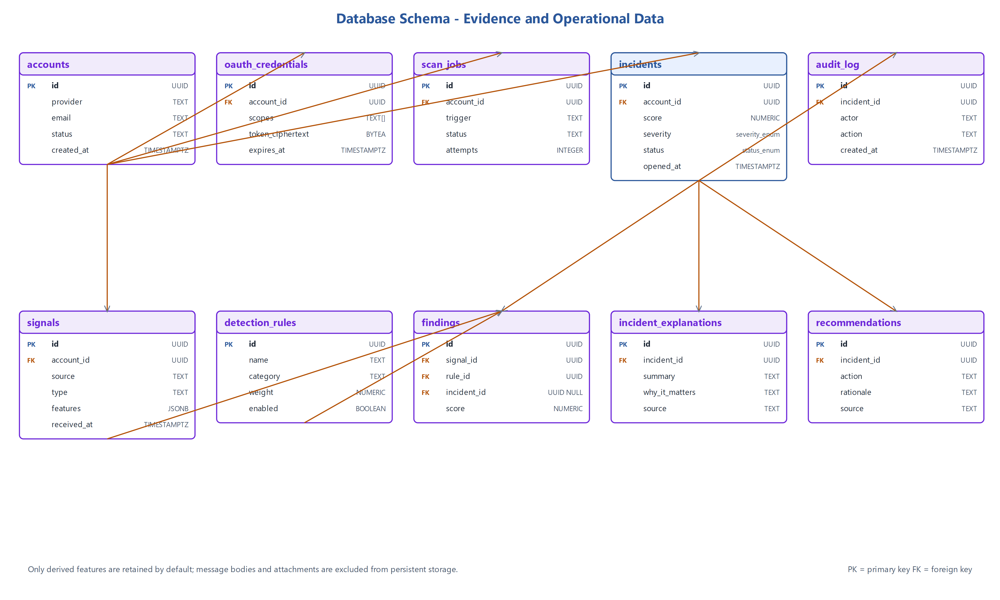

# Data Model and Evidence Chain

SentinelSME stores the minimum structured evidence needed to reproduce a
finding, explain an incident, and evaluate the rules. SQLite is the development
default; the ORM is designed to remain portable to PostgreSQL.



The diagram is the research design. The executable model adds explicit tenant,
source, confidence, fingerprint, and timestamp fields and intentionally omits
unprotected OAuth credentials; the personal Gmail adapter encrypts tokens.

## Persisted entities

| Entity/table | Purpose | Important fields |
|---|---|---|
| `app_users` | Verified app identity and unique workspace | Google subject (unique), verified email, random tenant ID (unique), creation time |
| `app_sessions` | Opaque eight-hour app session | SHA-256 token digest, user FK, CSRF digest, expiry; no provider tokens |
| `login_attempts` | Ten-minute browser-bound PKCE login | State/cookie hashes, encrypted verifier/nonce, expiry; single use |
| `accounts` | Monitored account within a tenant | `tenant_id`, email, provider, profile, status |
| `sources` | Controlled or authorised Gmail input | account, type, external ID, status, capabilities |
| `scan_jobs` | Requested unit of collection work | source, trigger, status, attempts, counts, error, timestamps |
| `scan_schedules` | Opt-in recurring bounded samples | source PK/FK, tenant, enabled, interval/sample limits, next eligibility, internal lease/expiry, failure count, last-job FK and update time |
| `alert_settings` | Workspace alert preferences | tenant PK, minimum severity, webhook switch and URL |
| `alerts` | One alert per incident severity | tenant, incident FK (cascade), severity, title, score, rule codes, webhook status, attempts, read time |
| `signals` | Privacy-minimised normalised event | source/account, external ID, type, time, correlation key, JSON features, fingerprint |
| `detection_rules` | Versioned deterministic rule configuration | code, signal type, title, weight, confidence, enabled, configuration, version |
| `findings` | One rule match against one signal | signal, rule code, optional incident, evidence, weight, confidence |
| `incidents` | Correlated review unit | account/key, title, summary, score, confidence, severity, status, time range |
| `incident_explanations` | Four-part human-readable explanation | incident, source (`template` or future `ai`), structured content |
| `recommendations` | Ordered safe next steps | incident, position, action, advisory flag |
| `audit_log` | Review and system history | tenant, optional incident, actor, action, state change, detail, time |

## Relationships

```text
Verified app user -> session -> server-assigned tenant (Google mode)
Tenant header (local demonstration mode)
  -> Account
      -> Source
          -> ScanJob
          -> Signal
              -> Finding -> DetectionRule
                   \-> Incident
                        -> IncidentExplanation
                        -> Recommendation
                        -> AuditRecord
```

A finding can temporarily have no incident while correlation is incomplete.
The detail API reconstructs the evidence chain without duplicating source data
inside the explanation.

## Core invariants

1. `(tenant_id, account email)` is unique.
2. `(tenant_id, source external_id)` is unique.
3. `(source_id, signal external_id)` is unique, making ingestion idempotent.
4. `(signal_id, rule_code)` is unique, so one rule cannot duplicate a finding
   for the same signal.
5. Account, source, job, incident, and audit queries are tenant-scoped.
6. An incident belongs to one account and one correlation key.
7. Finding weights and evidence are copied at detection time so later rule
   changes do not rewrite historical reasoning.
8. Recommendations are advisory and ordered.
9. Every accepted user lifecycle change produces an audit record.
10. A Google subject has one stable, random workspace; matching an email never
    adopts an older local-header workspace. All app sessions refer to that user.
11. Identity/session storage is separate from mailbox evidence and trial expiry.
    Sign-in access and ID tokens are transient; app cookies are stored as hashes.

Migration `76b18e25a901` adds only the three identity/session tables, after the
Gmail credential migration. Mailbox evidence schemas and deterministic scoring
are unchanged by onboarding. See `ONBOARDING.md` for lifetime and deletion policy.

## Normalised signal boundary

`signals.features` is JSON because each supported signal type has different
features. The persisted representation is deliberately smaller than the input:

| Signal | Retained examples | Removed or reduced |
|---|---|---|
| Email | canonical sender/reply-to, domains, display name, subject, labels, URL hosts, matched terms | Full body reduced to matched phrases; URL paths removed; attachments rejected |
| Forwarding | target address/domain, enabled, external, authorised | No mailbox body or credentials |
| Sign-in | source IP/country, device/travel/risk flags, success | No password, cookie, or token |
| MFA | enabled and method count | No secret seed or recovery material |
| OAuth grant | app name/ID, verified/broad flags, broad scope categories | No access/refresh token and no full token material |

The API rejects `attachment`, `attachments`, `attachment_content`, and
`raw_message` keys. Applications integrating with the platform must minimise
data before submission rather than using the database as a mailbox archive.

## Database configuration

The default URL is effectively:

```text
sqlite:///data/sentinelsme.db
```

Override it with `AI_SOC_DATABASE_URL`. Foreign-key enforcement is enabled for
SQLite connections. Application startup and the container entrypoint apply the
checked-in Alembic migration. Production operators must still add backups,
storage encryption, and retention automation before accepting live data.

## Historical target model

The Chapter 4 report includes an `oauth_credentials` table containing encrypted
token material and approved scopes. The personal Gmail adapter now implements this encrypted-token boundary with an external key and token lifecycle. The report remains a target for broader provider support. Do not introduce token persistence without
updating the threat model, privacy documentation, migrations, and security tests.

## Executable Gmail storage update

The new migration adds oauth_credentials (tenant/source, encrypted access/refresh
tokens and expiry JSON, update time), oauth_attempts (hashed state and browser
cookie, encrypted PKCE verifier, tenant/expected account, ten-minute expiry), and
accounts.delete_after. The token key stays outside the repository/database.

Seven-day Gmail trial expiry deletes the full local account evidence chain and
tokens at startup/next platform request. Reconnection does not extend expiry.
Manual deletion keeps a receipt with no account/message identifier. Token
encryption does not encrypt the full evidence database or backups.

## Evidence read models

`SignalPage`, `SignalDetail` and `IncidentPage` are derived API responses, not
new persistent tables. Pages include total/count/offset metadata and query the
same tenant-scoped entities. Signal detail joins copied findings and linked
incident summaries, including signals with no findings. It introduces no body,
attachment or duplicate evidence storage. The current rule catalogue shows
current configuration; copied historical finding weights/evidence do not imply
an immutable archive of every previous rule configuration.


## October analyst-console update

See [PRODUCT_SCOPE.md](PRODUCT_SCOPE.md) for the product comparison and necessary
completion milestones. Email normalisation now retains bounded payment phrase
groups and whitelisted supplied authentication observations. `EMAIL-006` requires
both payment-change and payment-action groups (weight 0.50, confidence 0.75).
Findings remain deterministic and traceable; existing signals are not re-scored.
No database migration or new connector scope is required. Shared screenshots and
evaluation exports must use controlled data; unit tests do not establish accuracy.

## Schedule migration and rule history

Migration `9d213bf807a2` adds source-scoped schedules and nullable last-job references. Account deletion removes schedules before jobs/sources. Internal leases are not exposed by the API. The rule import CLI rejects overwriting an existing code; copied weights/confidence and rule references on historical findings stay intact. See `SCHEDULING.md`.


## Trusted senders and sender history (migration `c3f1a7d2e9b4`)

- `trusted_senders`: tenant, kind (`address`/`domain`), normalised value, note,
  creator and time; unique per tenant/kind/value. Changes are audited by ID only.
- `sender_history`: tenant, account, account-salted SHA-256 sender digest,
  earliest time seen and message count; unique per account/digest; deleted with
  the account.
- Email features gain `trusted_sender`, `first_contact` and `local_scam_terms`.

## Public account and explanation lifecycle

AppUser.status is active or deleting. Session hashes are associated with the
server-owned workspace. RequestBudget stores short-lived hashed per-user action
counters without raw IPs, addresses or request content. ExplanationJob links a
workspace/incident/template revision, bounded retry count, lease, status and safe
failure reason. Incident/template deletion cascades queued work.

Production evidence retention deletes whole expired cases and their evidence,
leaving live cases intact. Connections persist until removed. Deletion receipts
are opaque workspace IDs in an independent durable volume, not the database.
The application database role is separate from the bootstrap administrator.
