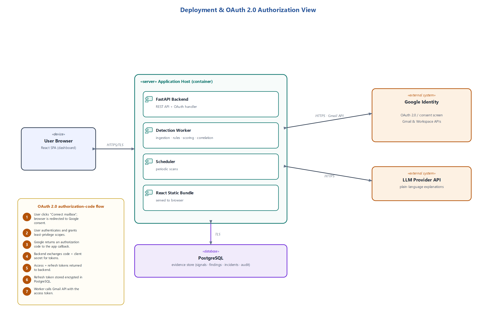

Public VPS operations and release gates: see [PUBLIC_DEPLOYMENT.md](PUBLIC_DEPLOYMENT.md). The private laptop instructions below remain available for controlled development.

# Operations Guide

This runbook covers the current local/research deployment. It does not claim
production readiness.

## Runtime layout



The report diagram shows the target boundary. Today, run these components:

```text
Browser -> Vite dashboard (development) -> FastAPI -> SQLite/PostgreSQL
                                      \-> deterministic processing in-process
```

The personal Gmail adapter executes bounded on-demand inbox collection inside
FastAPI and encrypts consent tokens. Operator credentials and live validation
are required; see [Gmail setup](GMAIL_SETUP.md). Workspace admin collection remains absent; optional loopback Ollama is available. An opt-in polling
worker executes bounded schedules; see [scheduling](SCHEDULING.md). Generic jobs
are consumed through explicit controlled ingestion.

## Configuration

| Variable | Default | Purpose |
|---|---|---|
| `AI_SOC_DATABASE_URL` | `sqlite:///data/sentinelsme.db` | SQLAlchemy database URL |
| `AI_SOC_ALLOWED_HOSTS` | `localhost,127.0.0.1,testserver` | Comma-separated accepted Host headers |
| `AI_SOC_API_KEY` | unset | Shared `X-API-Key` for local data routes; not used in Google mode |
| `AI_SOC_AUTH_MODE` | `local` | `google` enables invited app sessions; invalid values fail closed |
| `AI_SOC_INVITED_EMAILS` | unset | Comma-separated exact Google email invitation list |
| `AI_SOC_GOOGLE_LOGIN_REDIRECT_URI` | Gmail origin + `/api/v1/auth/callback` | Registered localhost app sign-in callback; same origin as Gmail |
| `VITE_API_BASE_URL` | empty | Browser API origin; empty uses Vite proxy/same origin |
| `AI_SOC_GOOGLE_CLIENT_ID` | unset | Local Gmail Web OAuth client ID |
| `AI_SOC_GOOGLE_CLIENT_SECRET` | unset | Server-only OAuth secret; use hidden local input |
| `AI_SOC_GOOGLE_REDIRECT_URI` | `http://127.0.0.1:5173/api/v1/gmail/callback` | Must match the registered localhost callback |
| `AI_SOC_TOKEN_KEY_FILE` | unset | External file containing the Fernet key |
| `AI_SOC_TOKEN_KEY` | unset | Alternative direct key, primarily for isolated tests |

Do not place secrets in committed `.env` files. The dashboard keeps a configured
API key in the browser session only; that still exposes it to anyone who can
inspect that browser session and is not a production authentication design.
Google mode replaces the user-facing shared key and tenant entry with verified
app identity and server-assigned workspaces. It reuses the server Google client
and external encryption key; participants do no Cloud Console setup. See
[operator onboarding](ONBOARDING.md) for callbacks, invitations, startup and
the necessary remote/public release gates. Run both UI and API through exactly
the configured origin, usually `http://127.0.0.1:5173`, rather than switching
between `localhost` and `127.0.0.1`.

## Local startup

API:

```bash
uv sync --dev --frozen
uv run alembic upgrade head
uv run uvicorn app.main:app --reload --host 127.0.0.1 --port 8000 --no-access-log
```

Dashboard:

```bash
cd frontend
npm ci
npm run dev
```

The dashboard is served at `http://127.0.0.1:5173`; the API and OpenAPI UI are
at `http://127.0.0.1:8000` and `http://127.0.0.1:8000/docs`.

## Health and capability checks

```powershell
Invoke-RestMethod http://127.0.0.1:8000/health
Invoke-RestMethod http://127.0.0.1:8000/health/ready
Invoke-RestMethod http://127.0.0.1:8000/api/v1/capabilities
```

If `AI_SOC_API_KEY` is enabled, pass `-Headers @{ 'X-API-Key' = '...' }` to the
capability call. A healthy process does not prove that an external connector is
available; inspect the capability response before enabling UI paths.

## Database operations

The SQLite default is suitable for a single local demo. Stop the API before
copying the database for backup or moving it between machines. Protect a backup
as sensitive evidence even though message bodies and attachments are excluded.

For PostgreSQL, use a least-privilege application role, TLS, encrypted storage,
private network access, and a separately managed backup policy. The checked-in
Alembic migration owns schema creation; deployment-specific backup and restore
testing is still required.

## Container startup

Copy `.env.example` to `.env`, replace both example secrets, and run:

```bash
docker compose up --build
```

The multi-stage image builds the React console, installs the locked Python
runtime, applies Alembic migrations, and serves the console and API on localhost
port `8000`. Compose starts a separate opt-in scan worker after API readiness. PostgreSQL is private to the Compose network and stores data in the
named `sentinelsme-data` volume.

Local Gmail trial expiry is enforced at startup/platform requests; general production retention remains pending. Plan and document deletion before using
real data; see `PRIVACY_AND_RETENTION.md`.

## Operational states

Scan jobs use `queued`, `running`, `completed`, or `failed`. Controlled ingestion
with a matching job moves it to running and then completed and updates import,
duplicate, and finding counts. With no worker, an unconsumed queued job remains
queued. A failed controlled ingestion marks its matching job `failed`; after
correcting the source or payload, explicitly queue it again with
`POST /api/v1/scan-jobs/{job_id}/retry`.

Sources use `active` or `disconnected`. A disconnected source cannot start a new
job or ingest signals. Re-activating a record changes local eligibility only; it
does not establish a remote provider connection.

## Monitoring and troubleshooting

| Symptom | Check |
|---|---|
| `400` from every request | Host header is absent from `AI_SOC_ALLOWED_HOSTS` |
| `401` under `/api/v1` | `AI_SOC_API_KEY` is set and `X-API-Key` is missing/wrong |
| Resource appears missing | Request uses a different `X-Tenant-ID` |
| `409` creating/ingesting | Duplicate stable identifier, disconnected source, mismatched scan/source, or invalid transition |
| Job stays queued | No worker exists; submit controlled signals with its job ID |
| No incident appears | No enabled rule met the 0.10 finding threshold |
| Repeated signal adds nothing | Same source and external ID is intentionally idempotent |
| No AI prose | Templates are the default; enable loopback Ollama explicitly; inspect model availability and fallback audit records |

Failed external calls must never be represented as a clean scan when live
connectors are added. Bound and sanitise stored error text.

## Isolated local benchmark

Run `uv run python -m app.benchmark --runs 3` from the repository root. It creates
fresh temporary SQLite databases, restores the original database configuration
and emits counts/timings as JSON. It does not populate the running workspace.
See [recorded results](BENCHMARK.md) for the input mix and measurement boundary.
Use the dashboard evidence workspace to inspect retained samples; no-match
records are searchable and do not imply safety.

## Production-readiness gate

Before production live-mail deployment or internet exposure, add and verify:

- real user authentication and server-derived tenant identity;
- role-based authorisation;
- TLS termination, secure proxy headers, and request/rate limits;
- reviewed database migrations and rollback procedure;
- encryption and rotation for provider token material;
- least-privilege OAuth consent, disconnect, expiry, and revocation;
- scheduled-worker ownership, retry policy, and dead-letter handling;
- automated retention/deletion and backup restoration testing;
- metrics, structured redacted logs, alerting, and incident response;
- dependency, secret, and container scanning;
- representative security, load, and usability evidence.

Until then, bind services to localhost or a controlled lab network and use only
synthetic or explicitly authorised data.


## October analyst-console update

See [PRODUCT_SCOPE.md](PRODUCT_SCOPE.md) for the product comparison and necessary
completion milestones. Email normalisation now retains bounded payment phrase
groups and whitelisted supplied authentication observations. `EMAIL-006` requires
both payment-change and payment-action groups (weight 0.50, confidence 0.75).
Findings remain deterministic and traceable; existing signals are not re-scored.
No database migration or new connector scope is required. Shared screenshots and
evaluation exports must use controlled data; unit tests do not establish accuracy.


The Windows Gmail helper applies an access DACL using the .NET ACL API for the
current PowerShell edition, without requiring an audit-policy privilege. Both the
private directory and token-key DACL are protected and restricted to the current
user. Credentials stay in process environment; a local configuration is not proof
of mailbox consent or successful collection. Restart using the existing local
credential file without printing its contents.

## Controlled acceptance and deployment record — 5 October

Native PostgreSQL 17.6 migration, user/scheduled scans, custom-format backup and restore passed on this Windows development computer. The temporary localhost server was stopped afterwards. See `evidence/postgresql-acceptance-2026-10-05.json`. Docker was unavailable, so Compose runtime verification remains pending.

Compose now starts the API/dashboard, database and polling worker. It publishes the API only on `127.0.0.1:8000`. Both app processes load the same protected server environment. Gmail requires the token-key file to be mounted read-only at its container path; the Windows setup file path is not automatically available inside a container. Set Gmail and login callbacks to the actual localhost port/origin and register both with Google. Controlled operation requires no Google variables.

After building/starting the stack, execute `docker compose exec -T api python -m app.demo --tenant container-acceptance`, then `docker compose exec -T api python -m app.worker --once --enable-demo --tenant container-acceptance`. The CI smoke uses `scripts/verify_container.py` to check served dashboard, readiness, actual completed user/scheduled jobs, duplicates and incidents. The database volume remains sensitive; backup/delete using the documented operator policy.

Start a local opt-in worker in the same configured terminal with `uv run python -m app.worker`. A stopped worker means no recurring collection; see `SCHEDULING.md`.


## Portable deployment and acceptance — 28 October 2026

`python scripts/run.py local --demo --model` builds the console and serves it
with the API on loopback. It uses `data/portable-demo.db`, a separate database;
open existing workspace `demo`. Omit `--model` to run fully without Ollama.
The launcher resolves the repository location from its own path, so an absolute
script invocation also works from another working directory. `--skip-build`
requires an existing complete frontend build; `--port` selects the listener.
No existing operator environment file is overwritten.

`python scripts/run.py docker --demo` generates random deployment secrets once
in ignored `data/docker.env` (POSIX mode 0600; Windows protection follows the
parent directory ACL). Keep that file private and preserve it with the database.
Do not put it in reports or screenshots. The launcher does not import the
operator's `.env` or mount host mailbox/token files. Docker builds the dashboard,
API and worker; PostgreSQL has no host port. The API binds only to host loopback.
Application containers run without Linux capabilities, with a read-only root,
temporary scratch space, and no-new-privileges. Forwarded headers are disabled;
this launcher is for localhost, not an internet-facing proxy deployment.

Add `--model` for `compose.ollama.yaml`: API, worker and Ollama share the API's
network namespace. Ollama listens on 127.0.0.1:11434 inside that namespace and
has no published port. The existing loopback-only validator is unchanged.
Model downloads require internet and occupy a separate named volume; the host's
Ollama installation is not reused. Container AI acceptance remains pending until
that profile is executed. Use the same `--model` option for check/down commands.
The container image pins the Ollama version; CPU inference is the default.

After startup, `python scripts/run.py check` executes `scripts/smoke.py` in the
API container. It creates a fresh labelled synthetic workspace and checks HTTP
readiness, HTML and referenced assets, ingestion/completed jobs, idempotency,
minimised evidence, tenant isolation, guidance, valid and invalid lifecycle
transitions, and audit records. It also tests rejection of an invalid API key
when a deployment key is configured. No Gmail consent or collection occurs.
Smoke workspaces remain as synthetic acceptance evidence. For a native server,
run `uv run python scripts/smoke.py`; inherit the server's API key if configured.
CI executes this HTTP check alongside the scheduled-worker Compose check.

`python scripts/run.py down` stops containers and retains volumes. Do not use
`down --volumes` on retained evidence. A different PC starts with fresh volumes;
copying the source alone does not transfer the database, model, provider tokens
or consent. Use a reviewed backup/restore process for authorised evidence.
For PostgreSQL, create a custom-format backup with `pg_dump -Fc` in the db
container, copy the resulting file out using `docker compose cp`, and restore
into a separate empty database using `pg_restore --exit-on-error --no-owner`.
Use the launcher's same env-file and Compose file arguments for these commands.
Verify counts and run acceptance checks before switching to a restored database.
Never overwrite the original volume as a restore test. Treat backups as sensitive.

Native acceptance on this laptop passed the HTTP smoke and controlled worker
checks; Docker runtime acceptance is recorded separately when actually executed.
The local Ollama evidence check produced 4/4 valid synthetic explanations,
repeat median 27.62 seconds, maximum 47.17 seconds, with no fallbacks. These timings do
not establish detection accuracy, explanation usefulness, or production readiness.

The portable Docker launcher requires at least 5 GiB free on the checkout drive before a build. `--skip-build` uses `--no-build` and an existing image. Docker Desktop is installed on this laptop, but the private container image, HTTP workflow, polling worker and PostgreSQL restore were subsequently verified. Both Compose configurations validate. This guard is headroom for image/build storage, not a guarantee of total capacity on every Docker host.


### Private deployment diagnostics and backups

The private acceptance run targets this laptop. The public VPS package and its separate acceptance are documented in PUBLIC_DEPLOYMENT.md. `python scripts/run.py doctor`
reports Docker CLI discovery, engine readiness, free disk, dashboard build and
whether a deployment env file exists. It never prints the file's contents and
works in an existing Windows terminal whose PATH predates Docker installation.
Engine startup was successfully verified on 28 October after a Desktop restart.

Logs rotate at 10 MB with three files per service. API, worker, PostgreSQL and
optional model have memory/process limits; application scratch tmpfs is 64 MB.
Memory defaults can be adjusted through `AI_SOC_API_MEMORY`,
`AI_SOC_WORKER_MEMORY`, `AI_SOC_DB_MEMORY`, and `AI_SOC_MODEL_MEMORY` (768m,
512m, 1g and 4g respectively). Docker allows a 150-second worker stop window before forced termination;
the database gets 60 seconds. Interrupted work still relies on the documented
lease recovery and idempotent ingestion rather than a claim of zero downtime. Verify these limits against the actual workload.

After the Compose database is running, create a private backup from the checkout:

```bash
python -m scripts.backup create
python -m scripts.backup verify data/backups/<generated-file>.dump
```

The helper streams `pg_dump -Fc` directly into a binary file, avoiding Windows
PowerShell binary redirection issues. Backups and a SHA-256 sidecar stay under
ignored `data/backups`. Failure removes only the partial file created by that
invocation. Verification checks the checksum before accessing Docker, restores
into a fresh randomly named `restorecheck_...` database, checks the schema and
aggregate evidence counts, then removes only that temporary database. It cannot
accept an existing database as a restore target. Restore failures are surfaced
and still clean up the temporary target. Never restore an untrusted archive.

Provider encryption keys and the deployment secret file are not included in
the dump. Keep them separately in protected storage; losing a token key makes
the corresponding encrypted provider tokens unusable. Backups contain retained
evidence and encrypted tokens and must remain private. The Windows file ACL is
inherited from the parent directory; protect that directory as well. These
helpers have regression tests. Real private and public-stack schema backup/restore checks passed on 28 October; the public check restores using the restricted application role.

The application image uses fixed UID/GID 10001. Application code and dependencies remain root-owned and readable; only the data directory is assigned to the application user. Dependency download caches are excluded from the runtime image.

## Why Compose is the laptop deployment

Decision (29 October 2026): this laptop runs the Compose stack, not a native
`uvicorn` process. Reasons, from what the repository and the running stack show:

- **Setup already exists.** `data/docker.env` (generated secrets), `data/compose.google.json`
  (Google sign-in and Gmail mounts), the Postgres volume and the optional model are
  saved. A native run would need a second database and a second Gmail consent, and
  could not read the Compose database or its encrypted tokens.
- **The worker comes with it.** Automatic scans and webhook alerts are delivered by
  the polling worker. Compose starts and restarts it with the API; natively it is a
  second terminal that is easy to forget.
- **Hardened and repeatable.** Read-only roots, dropped capabilities, bounded memory
  and logs, loopback-only port, PostgreSQL not exposed, the same image as CI.
- **Costs.** About 400 MB per image and a Docker Desktop dependency; builds need
  free disk (this drive had 5.2 GiB free on 29 October, below the launcher's
  5 GiB build guard once images accumulate; free space before large rebuilds).
  Never run `docker compose down --volumes`: it deletes evidence and the database.

Do not create a new `.env` or `data/docker.env`. A new `POSTGRES_PASSWORD` cannot
open the existing volume, and a new token key makes stored Gmail tokens unreadable.

## Deploy a new version (runbook)

1. Run the checks in `AGENTS.md` and commit.
2. Back up first when a migration is included:
   `uv run python -m scripts.backup create`, then `... verify data/backups/<file>.dump`.
   The verify output lists the current `schema_revision` and counts.
3. Confirm the private files exist: `data/docker.env`, `data/compose.google.json`, and
   the two files it mounts (`%LOCALAPPDATA%\LindaBiz\google-client-secret` and
   `token.key`). `restart.ps1` stops with a clear error if any is missing.
4. Build, then recreate with volumes preserved:
   `powershell -NoProfile -ExecutionPolicy Bypass -File scripts
estart.ps1 -Build -NoBrowser`
5. Verify: `curl http://127.0.0.1:8001/health/ready`; `docker compose ps` shows api, worker,
   db (and ollama) healthy; the worker log prints aggregate counts only; the database
   `alembic_version` equals the newest file in `alembic/versions`.

Migrations run automatically when the API and worker start. The Alerts migration
`a7c9e1d3b5f2` was applied this way on 29 October 2026 to the retained database
(15 incidents and 6 accounts unchanged). Existing incidents do not receive
alerts retroactively; alerts are raised for new or escalated incidents.

### Recovery notes from 29 October 2026

- `restart.ps1` refused to run because `%LOCALAPPDATA%\LindaBiz\token.key` and
  `google-client-secret` were missing from the host. The running containers still held
  the bind-mounted copies, so they were restored with `docker cp` from the running API
  container (`/run/secrets/local_token_key`, `/run/secrets/local_google_client_secret`)
  before recreating anything. Do this before any `--force-recreate`; once the old
  containers are gone the files cannot be recovered from Docker. Keep an offline copy
  of both files with the database backups.
- Windows PowerShell 5.1 treated Docker's progress output on stderr as an error and
  aborted the script. `restart.ps1` now sets `$ErrorActionPreference = 'Continue'`
  around the Docker calls and relies on its explicit exit-code checks.
- A second stack (`sentinelsme-public-acceptance`) was also running; it is separate,
  uses no ports on 8001, and was left untouched.

## Restart this laptop deployment

Run this single PowerShell command from any folder:

```powershell
powershell -NoProfile -ExecutionPolicy Bypass -File "C:\Users\HP\OneDrive\Desktop\y4\ai-soc-prototype\scripts\restart.ps1"
```

It starts Docker Desktop when needed, restarts the API/website,
collection worker, PostgreSQL and the installed optional model service, waits for
container health checks and API readiness, and opens
http://127.0.0.1:8001/. It preserves database/model volumes, private Google
credential mounts and the existing token encryption key. It never downloads a
model or silently falls back to unauthenticated local mode. Missing configuration
or a mismatched OAuth callback port fails with an actionable error.
Use `-Build` after source changes; the normal restart reuses installed images.
Use `-NoBrowser` to leave the browser closed. Google configuration is required
by default; `-LocalWorkspace` explicitly permits an unauthenticated local
workspace when no Google configuration exists. Live Google consent still requires
the registered callbacks and provider account approval.
